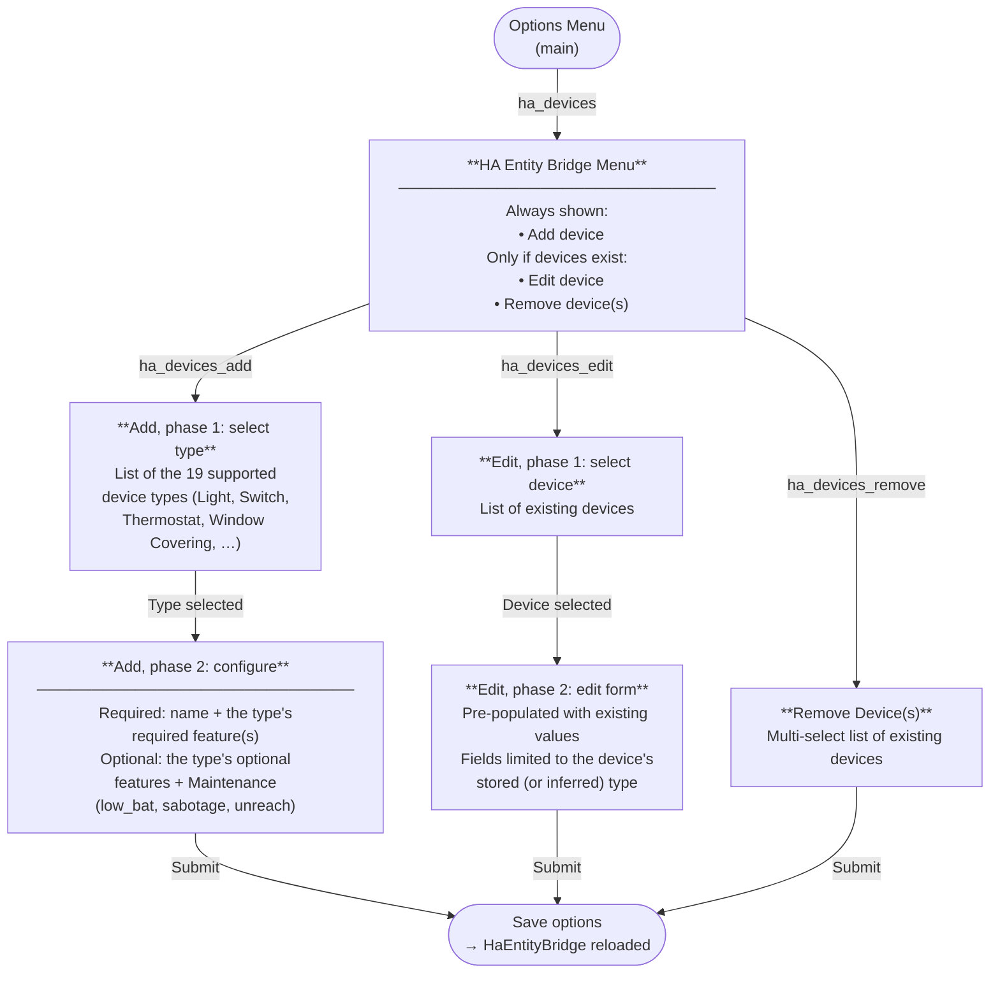

# HA Entity Bridge Flow (Alpha)

## Overview

The HA Entity Bridge exposes Home Assistant entities to the HCU as virtual plugin devices. The HCU sees them as native devices with typed features (for example `switchState`, `actualTemperature`, `maintenance`). It can display them, use them in automations, and control the controllable types.

The feature is configured via **Settings → Integrations → HCU → Configure → Home Assistant Entities → HCU**.

---

## Options Flow Diagram



---

## Step Details

### Menu (`ha_devices`)

| Condition | Available actions |
|-----------|-------------------|
| No devices configured | Add |
| ≥ 1 device configured | Add · Edit · Remove |

### Add Device (`ha_devices_add`), two phases

**Phase 1**, device type selector: list of all 19 supported types (see [Supported Device Types and Features](#supported-device-types-and-features)). The choice determines which fields phase 2 shows.

**Phase 2**, configuration form:

| Field | Type | Description |
|-------|------|-------------|
| `name` | Text | Display name shown on the HCU (required) |
| Required feature field(s) | Entity selector | The type's required feature(s), e.g. `on_off` for `SWITCH`/`LIGHT` |
| Optional feature fields | Entity selector | The type's optional features, plus Maintenance (`low_bat`, `sabotage`, `unreach`), always offered |

Each entity selector only offers the entity domains listed for its feature in `HA_FEATURE_DOMAINS` (`const.py`), see [Entity Domains](#entity-domains).

On submit: a new device dict `{id, name, type, features}` is appended to `CONF_HA_DEVICES` and options are saved. `type` is the value chosen in phase 1.

### Edit Device (`ha_devices_edit`), two phases

**Phase 1**, device selector: list of all configured devices (label = device name).

**Phase 2**, edit form: identical to phase 2 of Add, pre-populated with the existing entity assignments and limited to the fields relevant for the device's type. The `id` and `type` are preserved unchanged. The type itself cannot be changed here. Remove and re-add the device to change its type.

On submit: the device in `CONF_HA_DEVICES` is replaced in-place.

### Remove Device(s) (`ha_devices_remove`)

Multi-select list. Multiple devices can be deleted in one step.

On submit: selected `id`s are filtered out of `CONF_HA_DEVICES`.

---

## Device Type Detection

Since 2.2.0 the device type is chosen explicitly in the Add flow and persisted as `type` on the device dict. Several types (e.g. `EV_CHARGER` vs. `ENERGY_METER`, both just `power`/`energy`) share identical feature keys and can't be told apart from features alone.

`determine_ha_device_type()` in `const.py` still exists as a **fallback for devices saved before this field existed** (and is used opportunistically once, on first edit, after which the resolved type is persisted too). Its priority order:

```
LIGHT               if brightness / color_temp / rgb_color present
                    OR on_off entity starts with "light."
SWITCH              if on_off present (any other entity)
HEAT_PUMP           if climate_operation_mode present
THERMOSTAT          if set_point_temp present
WINDOW_COVERING     if shutter_level present
ENERGY_METER        if power or energy present
PARTICULATE_MATTER_SENSOR  if pm1 / pm25 / pm10 present
CLIMATE_SENSOR      if temperature / humidity / illuminance / co2 /
                       wind_speed / precipitation / storm / sunshine /
                       raining / wind_direction / sunshine_duration present
OCCUPANCY_SENSOR    if motion or occupancy present
CONTACT_SENSOR      if door, window, or contact_sensor present
SMOKE_ALARM         if smoke present
WATER_SENSOR        if moisture or moisture_detected present
VEHICLE             if vehicle_range present
BATTERY             if battery present
SWITCH              (fallback)
```

Note `EV_CHARGER`, `GRID_CONNECTION_POINT`, `HVAC`, `INVERTER`, and `SWITCH_INPUT` are intentionally absent from this list. They are only reachable via explicit selection in the Add flow.

---

## HCU Protocol Integration

Once saved, `HaEntityBridge` is active and responds to HCU plugin protocol messages:

### DISCOVER_REQUEST → DISCOVER_RESPONSE

All configured devices, of any of the 19 supported types, are offered as plugin devices. This is currently unverified against real HCU firmware for most types. If a `deviceType` value turns out to be rejected or ignored, restrict `_DISCOVERABLE_DEVICE_TYPES` in `ha_entity_bridge.py` back down.

A device that lacks a required feature of its type (for example an `ENERGY_METER` without `power`) is not offered. A warning names it once. It is still answered in status requests. A device without any configured entity is not offered and not reported.

Every feature is sent with its current value if one is known, otherwise as a bare descriptor (`{"type": "..."}`). `maintenance` is always included and carries `unreach`.

`modelType`/`firmwareVersion` reflect the *real* HA device behind the bridged entity when it belongs to one (via the entity registry → device registry lookup in `_get_ha_device_info()`), falling back to the generic placeholders (`"Homeassistant"` / `"0.0.0"`) for entities with no backing device (helpers, templates).

```json
{
  "deviceId": "ha.<uuid>",
  "friendlyName": "Living Room Light",
  "modelType": "Homeassistant",
  "firmwareVersion": "0.0.0",
  "deviceType": "LIGHT",
  "features": [
    {"type": "switchState", "on": true},
    {"type": "dimming", "dimLevel": 0.75},
    {"type": "maintenance", "unreach": false}
  ]
}
```

Devices we include this way are reported back by the HCU in its regular device list too, under an HCU-generated `id` (our `ha.<uuid>` only survives in a `pluginDeviceId` field there). `discovery.py` recognizes and skips these so they don't get re-imported into Home Assistant as a duplicate device.

### INCLUSION_EVENT / EXCLUSION_EVENT

Sent by the HCU when devices are included/excluded on its side.

- **INCLUSION_EVENT**: the included devices that are configured are activated and answered with one unsolicited `STATUS_RESPONSE` that carries their current state (`handle_inclusion_event`, Connect API 6.4.11). For any `ha.*` ID in the event that is no longer configured (removed from `CONF_HA_DEVICES` but still present on the HCU), a non-fixable repair issue (`ha_entity_excluded`) is created. It points at removing the device via the Homematic IP app, or re-adding it if the removal was unintentional (`handle_stale_inclusion_devices`).
- **EXCLUSION_EVENT**: the bridge stops reporting the excluded devices (`handle_exclusion_event`, Connect API 6.4.8). No `STATUS_EVENT` is pushed for them and status responses leave them out until an `INCLUSION_EVENT` names them again. A pending `on_time` auto-off still runs, so the entity is not left on. A repair issue for the device is removed.

### STATUS_REQUEST → STATUS_RESPONSE / STATUS_EVENT

Current HA state is read and mapped to HCU feature value objects. `STATUS_REQUEST` can ask for specific device IDs or (if none given) all of them.

```json
{
  "deviceId": "ha.<uuid>",
  "features": [
    {"type": "switchState", "on": true},
    {"type": "dimming", "dimLevel": 0.75},
    {"type": "maintenance", "lowBat": false, "sabotage": false, "unreach": false}
  ]
}
```

`STATUS_EVENT` is pushed automatically on every relevant HA state change, and once when the listener starts. It is only pushed for devices the HCU knows: devices offered in a `DISCOVER_RESPONSE` or named in an `INCLUSION_EVENT`, and not excluded since. A send is only throttled (max once per 5 seconds per device) if the resulting feature values are *identical* to what was last reported. An actually different value always goes out immediately, no matter how recently the last one was sent, so a real state change is never delayed or dropped by the throttle.

### Value Mapping

- **Units**: temperatures, temperature offsets, wind speed, power, energy, precipitation, vehicle range, sunshine duration and on time are converted from the unit of the entity to the unit of the Connect API (°C, km/h, W, kWh, mm, km, h, s). A missing or unknown unit means the value already has the Connect API unit.
- **Ranges**: values are limited to the ranges of the Connect API (for example -50 to 60 °C, 0 to 100 % humidity). Values that are not finite numbers are left out.
- **Enums**: `climateOperationMode` (`AUTO`, `COOLING`, `HEATING`), `presenceMode` (`AWAY`, `DEFAULT`, `HOME`, `NORMAL`, `VACATION`) and `shutterDirection` (`DARKER`, `LIGHTER`) are matched without regard to letter case. Other values are left out.
- **Shading levels**: the Connect API uses 0 to 1 where 1 is closed. A `cover` position (0 to 100, 100 is open) is inverted. A `number` entity counts as such a percentage if its unit is `%` or its `max` is greater than 1.01, otherwise its value is used as the level directly. A `cover` without a known position reports a shutter level of 1 for `closed` and 0 for `open`.
- **Climate entities**: `set_point_temp` reads the `temperature` attribute, `temperature` reads `current_temperature`, `humidity` reads `current_humidity`. Temperatures of a climate entity use the unit system of Home Assistant.

### CONTROL_REQUEST → CONTROL_RESPONSE

The HCU can control devices of the types `SWITCH`, `LIGHT`, `THERMOSTAT`, `WINDOW_COVERING` and `HEAT_PUMP`. All other types are status only.

| Feature | Device types | Home Assistant action |
|---|---|---|
| `switchState` | `SWITCH`, `LIGHT` | `turn_on` / `turn_off` of the `on_off` entity |
| `dimming` | `LIGHT` | `light.turn_on` with `brightness`, `light.turn_off` at level 0 |
| `colorTemperature` | `LIGHT` | `light.turn_on` with `color_temp_kelvin` |
| `color` | `LIGHT` | `light.turn_on` with `rgb_color` |
| `setPointTemperature` | `THERMOSTAT` | `climate.set_temperature`, or `set_value` of a `number` / `input_number` |
| `shutterLevel` | `WINDOW_COVERING` | `cover.set_cover_position`, or `set_value` of a `number` / `input_number` |
| `slatsLevel` | `WINDOW_COVERING` | `cover.set_cover_tilt_position`, or `set_value` of a `number` / `input_number` |
| `climateOperationMode`, `presenceMode` | `HEAT_PUMP` | `select_option` of a `select` / `input_select` |
| `coolingTemperatureOffset`, `heatingTemperatureOffset` | `HEAT_PUMP` | `set_value` of a `number` / `input_number` |
| `hotWaterBoost` | `HEAT_PUMP` | `turn_on` / `turn_off` of a `switch` / `input_boolean` |

Target values are converted back to the unit and scale of the entity and limited to its `min`/`max` (`min_temp`/`max_temp` for climate entities). The special values of the Connect API are honored: for `dimLevel`, `shutterLevel` and `slatsLevel` 1.01 means ignore and 1.005 means last value, and `color` and `colorTemperature` have their own ignore and last value codes. A `cover` that cannot be set to a position is opened at level 0 and closed at level 1; other levels fail.

The `CONTROL_RESPONSE` reports `success` and, on failure, an error object. The code is `UNKNOWN_DEVICE`, `FEATURE_NOT_SUPPORTED` (for example no entity configured for the feature) or `CONTROL_REQUEST_FAILED` (invalid value or failing Home Assistant action). Every feature of a request is applied, even after one failed. After the response the current state is pushed as a `STATUS_EVENT`.

**Optional `onTime` (auto-off timer)**

If an `on_time` entity is configured or the CONTROL_REQUEST itself contains an `onTime` value, the device is automatically turned off after the specified number of seconds.

Priority: value on the `switchState` feature > `onTime` feature in the same request > value of the configured `on_time` entity.

```
turn_on called
  └─ if on_time_secs > 0
       └─ async task: sleep(on_time_secs) → turn_off
```

A new `switchState` request cancels a pending auto-off timer of the entity before it starts a new one. A timer also ends when the entity is turned off by any other means.

---

## Maintenance Composite Feature

Three separate HA `binary_sensor` entities combine into a single HCU `maintenance` feature object. All three are optional.

| Config key | HCU field | Meaning |
|---|---|---|
| `low_bat` | `lowBat` | Battery low |
| `sabotage` | `sabotage` | Tamper contact triggered |
| `unreach` | `unreach` | Device unreachable |

`maintenance` is part of every DISCOVER_RESPONSE, STATUS_RESPONSE and STATUS_EVENT. `lowBat` and `sabotage` are included while their entity has a valid (not unavailable) state.

`unreach` is always reported. It is `true` while the configured `unreach` entity is on, or while the entities behind the device cannot be reached: a required entity of the type is missing or unavailable, or, for a device without a configured required entity, all of its entities are.

---

## Supported Device Types and Features

| Device type | Required | Optional | Controllable |
|---|---|---|---|
| `SWITCH` | `on_off` | `on_time`, Maintenance | yes |
| `LIGHT` | `on_off` | `brightness`, `color_temp`, `rgb_color`, `on_time`, Maintenance | yes |
| `ENERGY_METER` | `power` | `energy`, Maintenance | no |
| `PARTICULATE_MATTER_SENSOR` | none | `pm1`, `pm25`, `pm10`, Maintenance | no |
| `CLIMATE_SENSOR` | none | `temperature`, `humidity`, `illuminance`, `co2`, `wind_speed`, `precipitation`, `storm`, `sunshine`, `raining`, `wind_direction`, `sunshine_duration`, Maintenance | no |
| `OCCUPANCY_SENSOR` | `occupancy` | Maintenance | no |
| `CONTACT_SENSOR` | `contact_sensor` | Maintenance | no |
| `SMOKE_ALARM` | `smoke` | Maintenance | no |
| `WATER_SENSOR` | `moisture` | `moisture_detected`, Maintenance | no |
| `BATTERY` | `battery` | `power`, `energy`, Maintenance | no |
| `EV_CHARGER` | `power` | `energy`, Maintenance | no |
| `GRID_CONNECTION_POINT` | `power` | `energy`, Maintenance | no |
| `HEAT_PUMP` | `climate_operation_mode` | `cooling_temp_offset`, `heating_temp_offset`, `presence_mode`, `hot_water_boost`, `supply_temperature`, Maintenance | yes |
| `HVAC` | `power` | `energy`, Maintenance | no |
| `INVERTER` | `power` | `energy`, Maintenance | no |
| `SWITCH_INPUT` | none | Maintenance | no |
| `THERMOSTAT` | `set_point_temp` | `temperature`, `humidity`, `co2`, Maintenance | yes |
| `VEHICLE` | `battery` | `vehicle_range`, Maintenance | no |
| `WINDOW_COVERING` | `shutter_level` | `slats_level`, `shutter_direction`, Maintenance | yes |

**Maintenance** = `low_bat` + `sabotage` + `unreach` (all optional `binary_sensor` entities)

`motion` (for `OCCUPANCY_SENSOR`) and `door`/`window` (for `CONTACT_SENSOR`) are no longer offered in the Add/Edit form. The Connect API has only one feature for each (`PresenceDetected`, `ContactSensorState`), so `occupancy`/`contact_sensor` cover both. All old keys are still recognized on devices saved before this change (`LEGACY_FEATURE_FALLBACK` in `const.py` migrates them to the current key the next time the device is edited and saved), and `HaEntityBridge` only ever sends one entry per feature type regardless. See `_build_discover_features`/`_build_value_features` in `ha_entity_bridge.py`.

### Entity Domains

Feature keys that accept more than `sensor` or `binary_sensor` entities:

| Feature key | Entity domains |
|---|---|
| `on_off` | `switch`, `light` |
| `brightness`, `color_temp`, `rgb_color` | `light` |
| `on_time`, `cooling_temp_offset`, `heating_temp_offset` | `number`, `input_number` |
| `temperature`, `humidity` | `sensor`, `climate` |
| `set_point_temp` | `climate`, `number`, `input_number` |
| `shutter_level`, `slats_level` | `cover`, `number`, `input_number` |
| `shutter_direction` | `sensor`, `select` |
| `climate_operation_mode`, `presence_mode` | `select`, `input_select` |
| `hot_water_boost` | `switch`, `input_boolean` |
