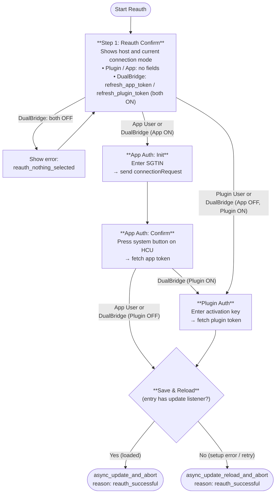

# Reauth Flow

## Overview

The reauthentication flow renews rejected or missing access tokens for an existing HCU config entry without changing its host, connection mode, unique ID, devices, entities, or options.

## When Reauth Starts

### Setup (`async_setup_entry` / `HcuCoordinator.async_setup`)

- **Plugin User**: if a WebSocket connection attempt during setup fails with an authentication rejection, setup stops immediately (without waiting for the remaining connect timeout), deletes any stale `setup_failed` repair issue, closes both sockets, and raises `ConfigEntryAuthFailed`. Home Assistant puts the entry into `SETUP_ERROR` and opens the reauth flow.
- **App User / DualBridge**: if the initial REST `getCurrentState` call fails with an authentication rejection, setup deletes any stale `setup_failed` repair issue, closes both sockets, and raises `ConfigEntryAuthFailed`.
- Transient network errors, timeouts, 5xx responses, and non-token-rejection error codes (such as `CLIENT_ACCESS_DENIED` or `NOT_ALLOWED_DURING_INITIALIZATION`) continue to raise `ConfigEntryNotReady` and retry with the `setup_failed` repair issue.

### Running Entry

- If a reconnect attempt on the primary WebSocket (`_listen_for_events`), the DualBridge Plugin WebSocket (`_listen_for_plugin_events`), or the post-reconnect state refresh (`_async_refresh_state_after_reconnect`) receives an authentication rejection, the coordinator calls `config_entry.async_start_reauth(hass)`, logs one warning per outage (with host and HTTP status or error code, never the token), and continues retrying with its normal backoff.
- If `_async_update_data` receives an authentication rejection, it raises `ConfigEntryAuthFailed`.
- Reauth is also started when an authorization check finds a missing client ID on the config entry.

### Token Rejection Rule (`is_auth_rejection`)

An error counts as a rejected token only when it is one of:

| Error | Rejection? |
|---|---|
| `aiohttp.WSServerHandshakeError` with HTTP status `401` or `403` | Yes |
| `HcuApiError` with `error_code == "INVALID_AUTHORIZATION"` (any HTTP status) | Yes |
| `HcuApiError` with `status_code` `401` or `403` and no `error_code` | Yes |
| `HcuApiError` with `status_code` `401` or `403` and any other `error_code` (e.g. `CLIENT_ACCESS_DENIED`) | No |
| Any other HTTP status, timeout, or network/connection error | No |

In `HcuApiClient.connect()`, the App User branch re-raises a `401` or `403` `WSServerHandshakeError` from port `8888` when no port connects (falling back to port `9001` in App-only mode still succeeds if `9001` connects).

## Flow Diagram

## Completion & Reload Behavior

- Existing steps for App User (`reconfigure_app_auth_init` → `reconfigure_app_auth_confirm` → `reconfigure_app_auth_finalize`) and Plugin User (`reconfigure_auth`) are reused without changing host or connection mode.
- Unselected tokens in DualBridge mode remain unchanged.
- When `self.source == SOURCE_REAUTH`, `_async_save_reconfigured_entry` aborts with `reauth_successful`:
  - If the entry already has update listeners (loaded), `async_update_and_abort` updates `entry.data` and lets `async_reload_entry` reload it once.
  - Otherwise (such as `SETUP_ERROR`), `async_update_reload_and_abort` updates `entry.data` and schedules one reload.
